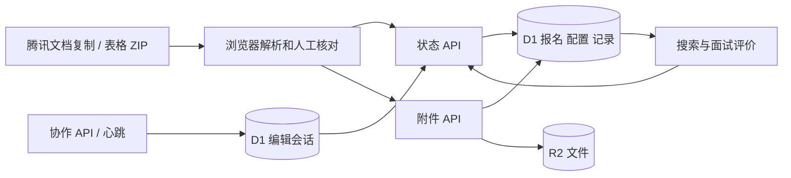

# 架构与数据流

| 位置 | 职责 |
| --- | --- |
| `app/page.tsx`、`app/layout.tsx` | 页面与元信息入口 |
| `components/interview/` | 工作台、详情、导入、设置、PDF、评分与协作 |
| `lib/talent.ts` | 类型、校验、默认规则、查重、评分与规则归档 |
| `lib/importer.ts` | 浏览器端表格/ZIP 解析、字段映射、材料建议匹配 |
| `lib/server.ts` | D1/R2、快照、变更、操作记录、撤回和写入授权 |
| `lib/presence.ts` | 席位上限、原子入场、过期回收、会话校验 |
| `lib/version.ts` | 产品版本 |
| `app/api/` | 状态、席位、附件 HTTP 入口 |
| `db/schema.ts`、`drizzle/` | 数据结构与迁移历史 |
| `build/`、平台脚本、`lib/connector-*` | Sites 平台集成，保留运行所需模板代码 |

`workspace` 保存共享配置、全局 revision 与原子写入 token；`candidates` 保存报名 JSON；`events` 保存操作与撤回信息；`attachments` 保存元数据及 R2 key；`editor_sessions` 保存租约。

所有人共用一个工作台。旧结构中的 `direction` / `directions` 仅为兼容保留，当前界面不提供组别功能。

入场使用 D1 原子批次：清理过期会话、条件插入、返回在线人数。上限为 5 个不同 `client_id`，同浏览器多个 `session_id` 共用席位。

报名写入校验席位、revision 和单条 `expectedUpdatedAt`。D1 batch 内 token 保护各条 SQL；不同报名碰撞最多尝试 5 次，同一报名过期返回 409。高竞争超过重试次数仍可能要求刷新重试。配置、导入、批量结果与撤回使用全局 revision 保护。

附件由独立 API 写入 R2 并更新 D1。线上存储与本地测试库独立。

## 测试

- `core.test.mjs`：查重、CSV、ZIP、导入、评分、历史规则保留。
- `presence.test.mjs`：SQLite 内存库验证席位、多标签、续期、到期、授权。
- `api.test.mjs`：500 人导入、保存/撤回、冲突、来源、附件校验与存取。
- `five-editors.test.mjs`：6 个独立 HTTP 会话，5 人入场、超额等待、15 次不同报名保存、同人冲突、撤回、同步、离开补位、已有数据保留。
- `scripts/test-integration.mjs`：每次新建本地 D1/R2，使用 Miniflare 执行构建后的 Worker，测试结束释放席位并关闭服务。

程序模拟不能代替五台实体电脑在实际网络中的浏览器验收。
